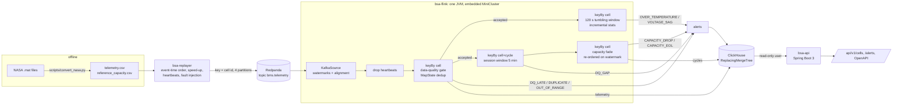

# battery-stream-alerts

Replays public battery-cycling lab data as if it were live BMS (battery management system)
telemetry, detects per-cell alerts in real time with **Apache Flink**, stores raw data and alerts in
**ClickHouse**, and serves them through a read-only **Spring Boot 3** REST API. Everything runs
locally with `docker compose`.

> Personal portfolio project, built in October 2026 with AI assistance, to practise Java backend and
> real-time data engineering (Java 17, Flink DataStream API, Kafka API via Redpanda, ClickHouse,
> Spring Boot, Docker Compose, JUnit 5, PIT). The data is replayed laboratory data, not a real
> battery fleet.

**中文摘要**：把 NASA 公开的锂电池循环老化数据当成 BMS 实时遥测回放进 Kafka（Redpanda），用 Flink（Java DataStream API，事件时间 + 水位线）按电芯计算过温、电压骤降、容量衰减和数据质量（缺数、越界、重复、迟到）告警，结果写入 ClickHouse（ReplacingMergeTree 幂等去重），再用 Spring Boot 提供只读 REST 接口。真实回放 185,721 个采样点：流式算出的每循环容量与 NASA 给出的容量平均差 0.84%，四个电芯的寿命终止（SOH<0.8）循环与 NASA 数据完全一致；注入的 40 重复 / 20 迟到 / 20 越界 / 20 丢点全部按数检出，40 个界内乱序零误报；中途 `kill -9` 作业后从 checkpoint 恢复，告警集合与无故障运行逐条一致。逐类讲解见 [docs/WALKTHROUGH.md](docs/WALKTHROUGH.md)（中文）。

## Architecture



| module | what it is |
|---|---|
| `bsa-core` | plain-Java model, JSON codec and all alert rules (no Flink dependency, so rules are unit- and mutation-tested in isolation) |
| `bsa-replayer` | CSV -> Kafka publisher: deterministic event-time order, configurable speed-up, heartbeats, seeded fault injection |
| `bsa-flink` | the Flink job (topology, keyed state, timers, windows, checkpoint-aware ClickHouse sink) |
| `bsa-api` | Spring Boot 3 REST API with validation, problem+json errors, OpenAPI |
| `clickhouse/` | schema + least-privilege users (created on first start) |

## Alerts

| type | rule (defaults) | evaluated in |
|---|---|---|
| `OVER_TEMPERATURE` | max temperature in a 120 s window > 40 degC | tumbling event-time window per cell |
| `VOLTAGE_SAG` | least-squares dV/dt of the under-load samples (I < -0.5 A) < -0.3 V/min, at least 5 such samples | same window, incremental aggregate |
| `CAPACITY_DROP` | cycle capacity (trapezoid integral of discharge current) more than 3 % below the mean of the previous 5 cycles | per cell, after each cycle's session window closes |
| `CAPACITY_EOL` | capacity / mean of the first 3 cycles < 0.80, raised once per cell | same |
| `DQ_OUT_OF_RANGE` | NaN or outside V 0..5, abs(I) <= 10 A, T -40..100 degC (sensor sanity, not operating limits); sample dropped | data-quality gate |
| `DQ_LATE` | event time <= current watermark (more than 20 s out of order); sample dropped | data-quality gate |
| `DQ_DUPLICATE` | (cell, cycle, seq) already seen; copy dropped | data-quality gate (keyed `MapState`, pruned by event-time timers) |
| `DQ_GAP` | sequence hole or > 60 s between consecutive samples inside a cycle | cycle session window |

**How the thresholds were chosen.** The sanity ranges are deliberately wide. The 40 degC
over-temperature limit is a *demo* value for lab data recorded at 24 degC ambient: a datasheet
discharge limit (typically about 60 degC) would raise no alerts at all on this data set, which
peaks at 42.3 degC. The sag rate, the 3 % drop and the 0.80 end-of-life line were picked after
looking at the distribution of the NASA data, so the alert counts below describe this data set
under these settings; they are not a validated detector. All values are environment-configurable
(`Thresholds.fromEnv`).

## Quick start

Requirements: Docker with Compose v2 (no local JDK or Maven needed; Maven runs inside
`maven:3.9-eclipse-temurin-17`). Python 3 with `scipy` only for the one-off data conversion.

```bash
# 1. get the NASA PCoE "Battery Data Set" (B0005, B0006, B0007, B0018 .mat files) and convert it
python scripts/convert_nasa.py --raw-dir /path/to/mat/files --out-dir ./data
# 2. bring up broker, ClickHouse, the Flink job and the API (builds the jars inside Docker)
docker compose up -d --build
# 3. full end-to-end run: replay, wait for the job to drain, collect numbers, smoke-test the API
bash scripts/demo.sh clean       # or: faults | crash | reprocess   (make demo / demo-faults / ...)
# 4. explore
curl -s localhost:18080/api/v1/cells | python -m json.tool
curl -s "localhost:18080/api/v1/cells/B0006/alerts?type=CAPACITY_DROP"
open http://localhost:18080/swagger-ui.html
docker compose --profile replay down -v
```

Ports (bound to 127.0.0.1): API 18080, ClickHouse HTTP 18123, Kafka 19092. Local demo passwords
are defaults in `docker-compose.yml`; override them via `.env` (see `.env.example`).

Memory limits add up to under 3 GB (Redpanda 512 MB, ClickHouse 768 MB, Flink job 896 MB, API
384 MB, replayer 320 MB).

## Results (real NASA replay)

All numbers below come from the JSON files in [`results/`](results/) written by
`scripts/collect_results.py` at the end of `scripts/demo.sh`, and are pinned by
`ReadmeNumbersTest` (the build fails if a number here differs from its file). Runs were made on
one laptop (WSL2, 8 vCPU, about 7 GB RAM, shared with other workloads) on 2026-10-13/14.

### Clean replay (`scripts/demo.sh clean`)

| metric | value | source |
|---|---|---|
| samples in the CSV | 185721 | <!-- e2e-clean.json:/replay/csv_rows --> |
| sample records sent to Kafka | 185721 | <!-- e2e-clean.json:/replay/sample_records_sent --> |
| heartbeat records sent (60 s event-time cadence x 4 partitions) | 56512 | <!-- e2e-clean.json:/replay/heartbeat_records_sent --> |
| replay speed-up (event seconds per wall second) | 5000.0 | <!-- e2e-clean.json:/speedup --> |
| replay wall time, ms | 195211 | <!-- e2e-clean.json:/replay/wall_ms --> |
| telemetry rows in ClickHouse (FINAL) | 185721 | <!-- e2e-clean.json:/rows/telemetry/final --> |
| discharge cycles summarised (FINAL) | 636 | <!-- e2e-clean.json:/rows/cycles/final --> |
| alerts (FINAL) | 923 | <!-- e2e-clean.json:/rows/alerts/final --> |
| OVER_TEMPERATURE windows | 607 | <!-- e2e-clean.json:/alerts_by_type/OVER_TEMPERATURE --> |
| VOLTAGE_SAG windows | 309 | <!-- e2e-clean.json:/alerts_by_type/VOLTAGE_SAG --> |
| CAPACITY_DROP | 3 | <!-- e2e-clean.json:/alerts_by_type/CAPACITY_DROP --> |
| CAPACITY_EOL | 4 | <!-- e2e-clean.json:/alerts_by_type/CAPACITY_EOL --> |

No data-quality alerts were raised on the unmodified data (no gaps, duplicates or out-of-range
values exist in it). All 3 `CAPACITY_DROP` alerts are on B0006; per-cell counts are in
`results/e2e-clean.json`.

**Cross-check against NASA's own numbers.** The stream job integrates current itself; NASA ships a
capacity per discharge cycle. Applying the same end-of-life rule to NASA's capacities gives exactly
the same cycle for every cell:

| check | value | source |
|---|---|---|
| cycles matched with NASA's capacity | 636 | <!-- e2e-clean.json:/capacity_vs_nasa/cycles_matched --> |
| mean abs. capacity difference, Ah | 0.01304 | <!-- e2e-clean.json:/capacity_vs_nasa/mean_abs_error_ah --> |
| max abs. capacity difference, Ah | 0.02802 | <!-- e2e-clean.json:/capacity_vs_nasa/max_abs_error_ah --> |
| mean relative difference, % | 0.84 | <!-- e2e-clean.json:/capacity_vs_nasa/mean_abs_relative_error_pct --> |
| B0005 EOL cycle, stream | 102 | <!-- e2e-clean.json:/end_of_life/B0005/stream_eol_cycle --> |
| B0005 EOL cycle, NASA capacities | 102 | <!-- e2e-clean.json:/end_of_life/B0005/nasa_capacity_eol_cycle --> |
| B0006 EOL cycle, stream | 61 | <!-- e2e-clean.json:/end_of_life/B0006/stream_eol_cycle --> |
| B0006 EOL cycle, NASA capacities | 61 | <!-- e2e-clean.json:/end_of_life/B0006/nasa_capacity_eol_cycle --> |
| B0007 EOL cycle, stream | 125 | <!-- e2e-clean.json:/end_of_life/B0007/stream_eol_cycle --> |
| B0007 EOL cycle, NASA capacities | 125 | <!-- e2e-clean.json:/end_of_life/B0007/nasa_capacity_eol_cycle --> |
| B0018 EOL cycle, stream | 77 | <!-- e2e-clean.json:/end_of_life/B0018/stream_eol_cycle --> |
| B0018 EOL cycle, NASA capacities | 77 | <!-- e2e-clean.json:/end_of_life/B0018/nasa_capacity_eol_cycle --> |

The difference is one-sided (mean signed = mean absolute): the stream integrates every sample's
discharge current until the cycle ends, so it is systematically about 0.013 Ah higher than NASA's
figure; the exact NASA procedure is not documented in the data set, so this is reported, not tuned away.

**Latency** (wall clock, all containers on one host clock). `ingest` = when the replayer sent the
record. Window alerts can only fire after the watermark passes the window end, so their latency
includes waiting for later data, which depends on the replay speed-up.

| latency, ms | value | source |
|---|---|---|
| telemetry: ingest -> row stored, p50 | 825 | <!-- e2e-clean.json:/latency_ms/ingest_to_stored (telemetry)/p50 --> |
| telemetry: ingest -> row stored, p95 | 2412 | <!-- e2e-clean.json:/latency_ms/ingest_to_stored (telemetry)/p95 --> |
| window alerts: ingest of last input -> emitted by Flink, p50 | 275 | <!-- e2e-clean.json:/latency_ms/alert_emit window (OVER_TEMPERATURE, VOLTAGE_SAG)/p50 --> |
| window alerts: ingest of last input -> emitted by Flink, p95 | 1574 | <!-- e2e-clean.json:/latency_ms/alert_emit window (OVER_TEMPERATURE, VOLTAGE_SAG)/p95 --> |
| window alerts: ingest of last input -> row stored, p50 | 1184 | <!-- e2e-clean.json:/latency_ms/alert_stored window (OVER_TEMPERATURE, VOLTAGE_SAG)/p50 --> |
| window alerts: ingest of last input -> row stored, p95 | 2708 | <!-- e2e-clean.json:/latency_ms/alert_stored window (OVER_TEMPERATURE, VOLTAGE_SAG)/p95 --> |

p99 and max are in the same file. Most of the stored-latency is the
sink's 1 s batching interval. Latency varied between runs on this shared machine: the fault-injection
run below measured a telemetry p95 of 1061 ms.

| same metric in the fault-injection run | value | source |
|---|---|---|
| telemetry ingest -> stored, p95 ms | 1061 | <!-- e2e-faults.json:/latency_ms/ingest_to_stored (telemetry)/p95 --> |

### Fault injection (`scripts/demo.sh faults`)

The replayer injected faults into randomly chosen cycles (seed 42, at most one per cycle, away
from cycle edges) and wrote down what the job should report:

| fault injected (count) | expected alerts | detected | source |
|---|---|---|---|
| 40 duplicates (re-sent 1 s later) | 40 `DQ_DUPLICATE` | 40 | <!-- e2e-faults.json:/dq_expected_vs_detected/DQ_DUPLICATE/detected --> |
| 20 late (delivered 30 min late) | 20 `DQ_LATE` | 20 | <!-- e2e-faults.json:/dq_expected_vs_detected/DQ_LATE/detected --> |
| 20 out-of-range (9.99 V) | 20 `DQ_OUT_OF_RANGE` | 20 | <!-- e2e-faults.json:/dq_expected_vs_detected/DQ_OUT_OF_RANGE/detected --> |
| 20 dropped | 60 `DQ_GAP`: one per hole (20 dropped + 20 late + 20 out-of-range) | 60 | <!-- e2e-faults.json:/dq_expected_vs_detected/DQ_GAP/detected --> |

| check | value | source |
|---|---|---|
| samples reordered by 5 s (inside the 20 s bound; must raise nothing) | 40 | <!-- e2e-faults.json:/replay/injected/REORDER --> |
| non-DQ alerts present only in this run vs the clean run | 0 | <!-- e2e-faults.json:/vs_clean_run/non_dq_only_in_this_run --> |
| non-DQ alerts present only in the clean run | 0 | <!-- e2e-faults.json:/vs_clean_run/non_dq_only_in_clean_run --> |

The in-bound reorders raised nothing, and none of the faults changed any temperature, sag or
capacity alert (the dropped samples sit inside cycles and are interpolated over).

### Crash recovery (`scripts/demo.sh crash`)

Mid-replay (after about 60 000 telemetry rows) the Flink container was `docker kill`ed (SIGKILL),
restarted 10 s later, found the newest retained checkpoint and restored from it, while the
replayer kept producing.

| metric | value | source |
|---|---|---|
| alert set identical to the clean run (ids compared) | true | <!-- e2e-crash.json:/vs_clean_run/identical_alert_set --> |
| telemetry rows, FINAL | 185721 | <!-- e2e-crash.json:/rows/telemetry/final --> |
| telemetry rows actually inserted by the sink | 187437 | <!-- e2e-crash.json:/rows/telemetry/inserted --> |
| alerts actually inserted by the sink | 925 | <!-- e2e-crash.json:/rows/alerts/inserted --> |

So 1 716 telemetry rows and 2 alerts written after the restored checkpoint (and before the kill)
were written a second time after the restart, exactly the at-least-once behaviour described under
Design decisions, and `ReplacingMergeTree` + `FINAL` removed them. The restore used checkpoint
`chk-11` (the log line is captured in `results/run/crash-restore.log`).

### Re-processing (`scripts/demo.sh reprocess`)

After the clean replay finished, the job was restarted with empty state and a new consumer group,
so it read the whole topic again and wrote every row a second time.

| metric | value | source |
|---|---|---|
| telemetry rows inserted (two full passes) | 371442 | <!-- e2e-reprocess.json:/rows/telemetry/inserted --> |
| telemetry rows, FINAL | 185721 | <!-- e2e-reprocess.json:/rows/telemetry/final --> |
| alerts inserted | 1846 | <!-- e2e-reprocess.json:/rows/alerts/inserted --> |
| alerts, FINAL | 923 | <!-- e2e-reprocess.json:/rows/alerts/final --> |
| telemetry `count()` without FINAL when measured (background merges had collapsed part of the copies) | 265466 | <!-- e2e-reprocess.json:/rows/telemetry/raw --> |
| alert set identical to the clean run | true | <!-- e2e-reprocess.json:/vs_clean_run/identical_alert_set --> |

### API smoke test

`scripts/api-smoke.sh` (run at the end of every demo) checks health, every endpoint, 404 for
unknown cells, 400 for an SQL-injection-shaped cell id, an over-large limit, an unknown alert type,
a missing or malformed `since`, and that the API's database user cannot `INSERT`. Output of each run:
`results/run/api-smoke-*.txt` (not committed); all 15 checks passed in every mode (clean, faults, crash, reprocess).

## Tests

| layer | where | what |
|---|---|---|
| rule unit tests | `bsa-core` (JUnit 5) | thresholds at exact boundaries, trapezoid integration, ordering independence, ring buffer, codec, config validation |
| operator tests | `DataQualityFunctionTest`, `CapacityFadeOrderTest` | Flink test harness: explicit watermarks, timer-based state cleanup, **dedup state survives snapshot/restore**, cycle summaries released in event-time order despite scrambled arrival |
| topology tests | `PipelineMiniClusterTest` | real MiniCluster, parallelism 2: streaming result == batch oracle on the synthetic fixture; injected duplicates / in-bound reorders / late / out-of-range / heartbeats detected exactly; two runs give identical alert ids |
| sink tests | `ClickHouseWriterTest` | fake ClickHouse (JDK `HttpServer`): batching, flush on checkpoint, 5xx retry, no 4xx retry, rows kept for replay on failure |
| API slice tests | `BatteryControllerTest`, `OpenApiDocTest` | validation, 400/404/503 problem+json, parameter pass-through, OpenAPI content |
| replayer tests | `ReplayPlanTest` | determinism per seed, fault shapes, one fault per cycle, heartbeat placement, pacing |
| README pins | `ReadmeNumbersTest` | every number in the Results section equals its results file |

`mvn verify` runs all of the above without Docker; CI (`.github/workflows/ci.yml`) runs it on
ubuntu-latest with JDK 17 and then runs PIT. The end-to-end runs need Docker and the NASA files, so
they are not in CI.

**Mutation testing.** PIT on the alert rules (`bsa.core.rules`): first run 204/233 mutants killed
(87.6 %); the survivors exposed six untested behaviours, which `MutationGapTest` now covers; second
run **219/233 (94.0 %)**. The 14 survivors are listed with reasons in
[`results/pit-summary.md`](results/pit-summary.md) (11 equivalent, 3 in an informational field).

**Hand-made mutations.** `scripts/hand-mutations.sh` introduces 20 deliberate bugs, one at a time,
across all modules (Flink wiring, watermark bound, sink flush, API validation, replayer ordering) and
runs the tests: first pass 18 of 20 caught. One survivor (replayer re-sort) was a real gap and now has a test; the other turned out to be equivalent because Flink fires event-time timers in timestamp order. Details: [`results/hand-mutations.md`](results/hand-mutations.md).

**A bug the tests caught during development.** The first version of the capacity-fade operator
processed cycle summaries as they arrived. With parallelism 2, summaries from different window
subtasks overtook each other on the network (only watermarks are coordinated across channels), so
the rolling baseline was computed in the wrong order and end-of-life was reported on the wrong
cycle. The MiniCluster test's batch-oracle comparison failed; the fix parks summaries in keyed state
and releases them in event-time order when the watermark passes (`WindowFunctions.CapacityFade`).

## Design decisions

**Why Flink.** The problem needs event-time windows (tumbling and session), per-key state with
timers (dedup, capacity history), late-data handling and checkpointed recovery. Flink's DataStream
API has all of these as first-class primitives. Kafka Streams could do it too; Spark Structured
Streaming works in micro-batches and gives less control over per-record state and timers. The job
runs in an embedded MiniCluster (local environment) inside one ~900 MB container: same API,
operators, state and checkpoints as on a cluster, without a JobManager/TaskManager deployment.

**Event time and watermarks.** Each record carries its measurement time. Watermark = max event
time seen - 20 s, emitted per record (punctuated), so results depend on record order only and tests
are deterministic. Anything arriving with a timestamp at or below the watermark is late: the
data-quality gate reports it as `DQ_LATE` and drops it instead of using `allowedLateness`, so window
results are final when written. Windows also route late data to a side output as a safety net; it
stayed empty in every run (the `DQ_LATE` counts above match the injections exactly).

**Heartbeats and watermark alignment.** A Kafka partition without data would hold the job's
watermark back forever (B0018's test started three months after the other cells), so the replayer
sends a heartbeat to every partition each 60 s of event time and one final heartbeat an hour after
the last sample to close all windows. Watermark alignment (max drift 600 s) stops one partition from
being consumed far ahead of another, which would make the late/on-time decision depend on consumer
scheduling. Alignment has a cost: the first demo run used 60 s drift / 200 ms updates and the job
crawled at about 130 records/s while the replayer sent about 2 200/s; it now uses 600 s / 50 ms.

**Delivery semantics and idempotency.** Flink state is exactly-once (aligned checkpoints). The
ClickHouse sink is **at-least-once**: Flink calls `flush()` before every checkpoint barrier, so all
rows before a completed checkpoint are stored; after a failure everything since that checkpoint is
replayed and may be written twice. Results are still effectively exactly-once because every row has
a deterministic key (sample = cell + cycle + seq; alert id = UUID of cell + type + window/cycle/sample)
and the tables are `ReplacingMergeTree`, which collapses rows with the same sorting key; the API reads
with `FINAL`. Two-phase-commit exactly-once was not attempted because ClickHouse has no multi-batch
transactions. The replayer uses Kafka's idempotent producer, so producer retries do not duplicate
records in the topic.

**ClickHouse layout.** `telemetry` is ordered by `(cell_id, event_time, cycle, seq)` and partitioned
by month: the dominant query is one cell over a time range. `alerts` is ordered by
`(cell_id, alert_type, event_time, alert_id)`. `cycles` is tiny and ordered by `(cell_id, cycle)`.
`ReplacingMergeTree(inserted_at)` keeps the newest copy of a key. `FINAL` is fine at this size; on a
large table one would read through `argMax` aggregations or a deduplicated materialized view.
Two least-privilege users: `bsa_writer` (INSERT only) for Flink and `bsa_reader` (SELECT only,
readonly profile) for the API.

**API.** Read-only, versioned under `/api/v1`. Inputs are validated before any SQL runs (cell id
whitelist regex, enum alert types, bounded limits, ISO-8601 times) and every value reaches SQL as a
bind parameter. Errors are RFC 9457 `problem+json`; database errors return 503 without leaking SQL
or host names. OpenAPI document at `/v3/api-docs`, Swagger UI at `/swagger-ui.html`, health at
`/actuator/health` (includes a database check).

## Limits

- Single node: one broker, one ClickHouse server, the Flink job in an embedded MiniCluster. No
  high availability; recovery after a container crash relies on the checkpoint volume.
- Replayed laboratory data (4 cells, constant-current discharge at 24 degC), not a real BMS and not
  a fleet. Thresholds are demo values (see above).
- Only discharge cycles are replayed; charge and impedance measurements are ignored.
- Gaps at the very end of a cycle cannot be detected (the expected sample count is unknown).
- Capacity is the integral of all discharge current in the cycle; it differs from NASA's figure by
  0.84 % on average.
- `FINAL` queries are not how one would serve a large table.
- Testcontainers was not used: the build runs inside a Maven container without access to a Docker
  daemon, so database-level integration is covered by the compose-based `scripts/demo.sh` and
  `scripts/api-smoke.sh` instead.

## Data

B. Saha and K. Goebel (2007). *Battery Data Set*, NASA Prognostics Data Repository, NASA Ames
Research Center, Moffett Field, CA. The catalog page does not state a licence, so neither the raw
`.mat` files nor the converted CSV are in this repository. `scripts/convert_nasa.py` documents the
conversion (discharge cycles only; event time = cycle start date vector, read as UTC, + `Time`).
The only data committed is `fixtures/synthetic_telemetry.csv`, a small synthetic file generated by
`scripts/make_synthetic_fixture.py` for the tests.

## Repository layout

```
bsa-core/       model, codec, alert rules (+ unit tests, PIT config)
bsa-replayer/   CSV -> Kafka replayer
bsa-flink/      Flink job, ClickHouse sink (+ harness and MiniCluster tests)
bsa-api/        Spring Boot API (+ MVC slice tests)
clickhouse/     schema/users init script, low-memory config
scripts/        convert_nasa.py, demo.sh, api-smoke.sh, collect_results.py, hand-mutations.sh, mvn-docker.sh
results/        e2e-*.json (pinned in this README), pit-summary.md, hand-mutations.md
docs/           WALKTHROUGH.md (Chinese walkthrough of every class)
fixtures/       synthetic test data
```

## License

Code: MIT (see `LICENSE`). NASA PCoE battery data (Saha & Goebel 2007) is not redistributed; only a synthetic test fixture and aggregate results are committed.
